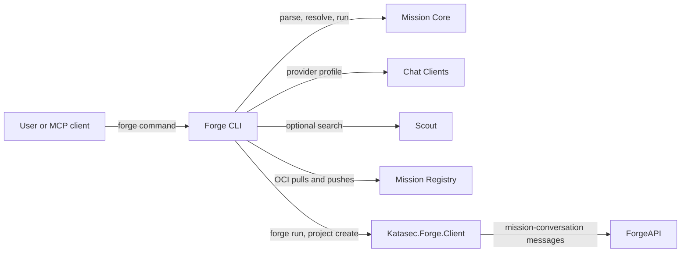

# Forge CLI

## Purpose

Exposes the `forge` executable and composes existing components into user-facing commands.

## Why this exists

One command surface connects mission setup, cloud runs, publishing and `forge mcp`. The CLI
handles user input and output; the components it calls own language semantics, provider protocols,
and services.

## Owns

- Command registration, arguments, output, and mission-file selection.
- CLI wiring for OCI pulls and pushes, platform sign-in, and the MCP command.
- `forge run` output, including the `--verbose` turn transcript on stderr.

## Does not own

- MCL parsing or execution, provider SDK adaptation, or search.
- Project and mission-authoring rules, durable conversation state, or Bob's capability authority;
  `forge run` and `forge project create` compose those services through `Katasec.Forge.Client`
  from [forge-client](https://github.com/katasec/forge-client).

## Change admission

Change this component for command behavior or composition. Change [Parser](../ForgeMission.Parser/README.md)
for syntax and [Core](../ForgeMission.Core/README.md) for resolution and execution. For provider
construction or search, change the corresponding component. Keep client-service behavior in
forge-client.

## Use these pieces

| Piece | Responsibility |
|---|---|
| [Program](Program.cs) | Executable entry point, command registration, and command handlers. |
| [ForgeDurableRun](Commands/ForgeDurableRun.cs) | `forge run`: one turn of a mission as a cloud conversation in the project, with Hands. |
| [RunInputs](Commands/RunInputs.cs) | `forge run --input`: parses and checks named inputs and builds the turn's `MissionNamedInputs`. |
| [RunTranscript](Commands/RunTranscript.cs) | `forge run --verbose`: one stderr line per expert step, Hands use, error or unfinished run. |
| [McpCommand](Commands/McpCommand.cs) | `forge mcp`: serves one validated mission over stdio, runners built by [MissionServerBuilder](Services/MissionServerBuilder.cs). |
| [PlatformLogin](Commands/PlatformLogin.cs) | Platform sign-in, key retrieval, `whoami`, and logout. |
| [ProviderClientBuilder](Services/ProviderClientBuilder.cs) | Optional live-search wiring from xAI/Grok environment keys. |
| [ForgeProject](Commands/ForgeProject.cs) | Explicit portable Project creation through the shared Client. |
| [ImmediateProgress](Services/ImmediateProgress.cs) | Shows the shared Client's Hands reports at once, in order. |
| [ForgeSettings](Services/ForgeSettings.cs) | The `~/.forge/config.json` settings (API endpoint, OCI endpoint for short mission selectors) bound by the CLI host. |

## Communicates with

## Important flows and constraints

- **Run:** `forge run <mission.mcl|oci-ref> "<prompt>"` reads `./forge.project.json`, or the file
  given by `--project <file>`, and starts a new conversation each launch through the Client
  (`StartAsync`, `ProjectConversation.RunTurnAsync`). The run is a cloud conversation in the
  Conversation Host, readable after the CLI exits. A missing project stops with the Client's one
  message naming `forge project create`. The final answer goes to stdout; diagnostics, the
  `--verbose` transcript and the conversation ID go to stderr.
- **Named inputs:** `--input name=value` (text) and `--input name=@file` (uploads one file, at most
  100 MiB; a folder is refused) are repeatable. The prompt fills the root mission's own input, so
  `--input` cannot name it. With any `--input`, the turn is submitted as named inputs through the
  Client (`UploadInputAsync`, then `RunTurnAsync` with `MissionNamedInputs`). Every value is checked
  before any network call.
- **Hands:** Always attached by the Client when the conversation opens; there is no flag or
  prompt. Agent experts may Read/Write/Edit inside the project's folders and nowhere else; terminal
  tools are not granted. Hands owns path and symlink containment. Hands reports print on stderr
  as `error: …`.
- **Composition:** `Program` wires existing owners. Provider and search behavior belong in
  [Chat Clients](../ForgeMission.ChatClients/README.md) and [Scout](../ForgeMission.Scout/README.md);
  OCI retrieval belongs in [Mission Registry](../ForgeMission.MissionRegistry/README.md).
- **Project creation:** `forge project create [folder]` writes `forge.project.json` (`folders: ["."]` and a new `projectId`) unless one is already there. The folder defaults to cwd and must exist. It makes no server call and needs no sign-in; forge-client's Projects owner holds the file rules. A rerun keeps the existing Project.
- **Portable files:** `forge.project.json` carries the stable `projectId`, mission/version
  references and relative repository folders.
- **MCP:** `forge mcp <mission.mcl>` runs the mission locally in-process for each tool call; its
  runners come from `forge.toml` profiles, built lazily so startup needs no API key.
- **AOT:** Preserve source-generated JSON and reflection safety.

## Tests

| Area | Start here |
|---|---|
| Run | [ForgeDurableRunTests](../../tests/ForgeMission.Mcl.Tests/Cli/ForgeDurableRunTests.cs), [RunTranscriptTests](../../tests/ForgeMission.Mcl.Tests/Cli/RunTranscriptTests.cs) |
| Commands and config | [CLI test directory](../../tests/ForgeMission.Mcl.Tests/Cli) |

## Related documentation

- [Architecture](https://github.com/katasec/mission-control-language/blob/main/docs/design/architecture.md)
- [MCL language](https://github.com/katasec/mission-control-language/blob/main/docs/design/language.md)
- [Conversation flow](https://github.com/katasec/mission-control-language/blob/main/docs/design/how-conversations-work.md)
- [Build and install](../../README.md#build)
