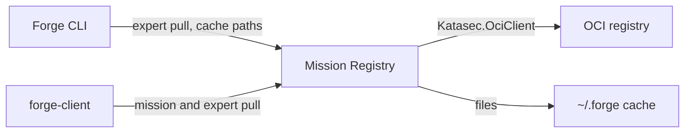

# Mission Registry

## Purpose

Parses Forge OCI locators, pulls immutable expert or mission content, and keeps the local
`~/.forge` cache those pulls write to.

## Why this exists

Both the `forge` CLI and forge-client pull experts and missions from OCI registries. One small
AOT-compatible package keeps locator parsing, content verification and cache layout in one place,
apart from mission execution and from any user interface.

## Owns

- OCI locator parsing and normalization: [`OciReference`](OciReference.cs).
- Pulling one expert document: [`OciExpertPuller`](OciExpertPuller.cs).
- Pulling and safely extracting a mission bundle: [`OciMissionPuller`](OciMissionPuller.cs).
- The cache layout under `~/.forge/experts` and `~/.forge/missions`, and its only eviction (`Clear`): [`ForgeCache`](ForgeCache.cs).

## Does not own

- The `mcl.lock` format, including how a cached expert path is written into it. `ForgeMission.Core`
  owns that (`LockFile`, `LockFileIO`, `ExpertResolver.ToLockPath`).
- Publishing or pushing missions; `forge publish` uses `Katasec.OciClient` directly.
- Saving registry credentials; `forge registry login` saves them through Core's `CredentialStore`.
- Choosing which reference to pull, a mission catalog, hosted execution, or any user interface.

## Change admission

A change belongs here only if it changes how an OCI locator is read, how content is pulled and
verified, or where it is cached. For the lock file change `ForgeMission.Core`; for command
behaviour change `ForgeMission.Cli`.

## Use these pieces

- `OciReference.Resolve` normalizes a repository selector against an explicit registry base.
  `OciReference.Parse` reads the older `registry/name@reference` form. `ResolveTagged` reads a publish
  target with the `Resolve` grammar and requires an explicit tag.
- `OciExpertPuller.PullVerifiedAsync` takes the registry token from the caller.
  `OciExpertPuller.PullAsync` reads it itself: `FORGE_REGISTRY_TOKEN`, else `~/.forge/credentials.json`.
- `OciMissionPuller.PullVerifiedAsync` takes the registry token from the caller and returns the
  cached mission directory.
- [`OciMissionPullerTests`](../../tests/ForgeMission.Mcl.Tests/Registry/OciMissionPullerTests.cs) and
  [`OciReferenceTests`](../../tests/ForgeMission.Mcl.Tests/Registry/OciReferenceTests.cs) cover bundle
  extraction, cache checks and locator parsing.

## Communicates with

## Important flows and constraints

- Cache entries are keyed by content digest, so an existing entry must match the verified content
  byte for byte, or the pull fails.
- A mission bundle is at most 32 MiB and 4096 entries and must contain `mission.mcl`. Only
  regular files and directories are accepted. Absolute, traversal and duplicate paths are rejected,
  and so are links and devices. Directory entries are skipped, since directories are created from
  file paths.
- Extracted files ignore the entry's mode: they are created owner read/write, others read-only,
  and never executable.
- Expert and mission writes are atomic: content is staged beside the cache entry and moved into
  place.
- The package is Native-AOT compatible and targets `net10.0`.

## Related documentation

- [Architecture](https://github.com/katasec/mission-control-language/blob/main/docs/design/architecture.md)
